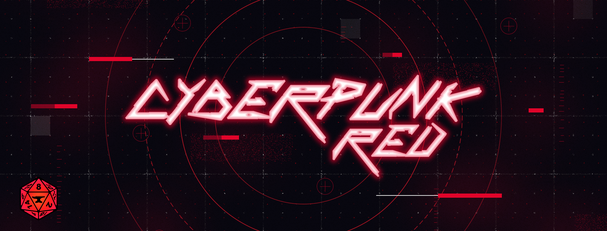

# Cyberpunk RED - Welcome to The Street! (Foundry VTT v14 Fork)



> **Unofficial Foundry VTT v14 Fork Notice**  
> This repository is an **unofficial community fork** adapting the `dev` branch (`0.93` in development) of **Cyberpunk RED - CORE** for **Foundry VTT v14**.  
> All credit for the system belongs to **The Project Red Team**. Please check out, follow, and support the original project on GitLab:
>
> - **Original Repository (Upstream):** <https://gitlab.com/cyberpunk-red-team/fvtt-cyberpunk-red-core>
> - **Official Foundry VTT Package:** <https://foundryvtt.com/packages/cyberpunk-red-core>
> - **Original Community Discord:** <https://discord.gg/p5zYEQTV2R>

<!-- markdownlint-disable-next-line MD033 -->
<div align="center">

[](https://foundryvtt.com/)
[-fc6d26?logo=gitlab)](https://gitlab.com/cyberpunk-red-team/fvtt-cyberpunk-red-core)
[](LICENCE.md)

<!-- markdownlint-disable-next-line MD033 -->
</div>

An implementation of the Cyberpunk RED Core rules for Foundry VTT, patched in this fork for Foundry v14 compatibility (manifest compatibility `14`, retired `legacyTransferral` removal, Active Effects v2 `system.changes`/`type`/`phase`/`shouldApplyChange`, `ImagePopout`/`ContextMenu` updates, AppV2 unlinked token sheet closing, and migrated compendium YAML packs).

> Disclaimer: This game system is unofficial content provided under the [Homebrew Content Policy](https://rtalsoriangames.com/homebrew-content-policy/) of R. Talsorian Games and is not approved or endorsed by RTG. This content references materials that are the property of R. Talsorian Games and its licensees.

If you want to contribute upstream or report issues with the official system, please support the original authors at [The Project Red Team's GitLab](https://gitlab.com/cyberpunk-red-team/fvtt-cyberpunk-red-core) and their [issue tracker](https://gitlab.com/cyberpunk-red-team/fvtt-cyberpunk-red-core/-/issues/new). Issues specific to this v14 adaptation should be reported on [this fork's GitHub Issues](https://github.com/Arcticzx/fvtt-cyberpunk-red-core-fork/issues) so upstream isn't flooded with unsupported v14 reports.

## Getting Started

If you are a GM or player and curious about how Cyberpunk runs in Foundry VTT, why not check out the original project's extensive [wiki](https://gitlab.com/cyberpunk-red-team/fvtt-cyberpunk-red-core/-/wikis/home), or Tales From Trantor's Cyberpunk RED [playlist](https://www.youtube.com/playlist?list=PL4-W5wKEr1fm57F9qnF8a7opYJ1pBt36X).

## Installing This Foundry v14 Fork

1. Open Foundry VTT v14 and go to **Game Systems → Install System**.
2. Paste this **Manifest URL** at the bottom:

   ```text
   https://github.com/Arcticzx/fvtt-cyberpunk-red-core-fork/releases/latest/download/system.json
   ```

3. Click **Install**.

For the **official upstream version** (Foundry v12), use the [Foundry VTT package page](https://foundryvtt.com/packages/cyberpunk-red-core) or the official manifest [here](https://gitlab.com/api/v4/projects/22820629/packages/generic/fvtt-cyberpunk-red-core/latest/system.json).

## Release Notes

- Changes for this fork are published under [GitHub Releases](https://github.com/Arcticzx/fvtt-cyberpunk-red-core-fork/releases).
- Upstream release notes are available on the original [GitLab Releases Page](https://gitlab.com/cyberpunk-red-team/fvtt-cyberpunk-red-core/-/releases) and [development changelog](CHANGELOG.md).

## Join the Community!

You can find our main community on [Discord](https://discord.gg/p5zYEQTV2R), where GMs and players alike talk about the project and Cyberpunk RED more widely. We'd love to see you there!

If you'd like to get in touch with someone specific, our contact information can be found on the wiki [here](https://gitlab.com/cyberpunk-red-team/fvtt-cyberpunk-red-core/-/wikis/home#project-red-cast-of-characters).

Interested in helping out? We would love to hear from you! We also coordinate our work on [Discord](https://discord.gg/p5zYEQTV2R), so head on over there and say hello.

If you'd like to get a sense of the project's direction, the tools we use, and how we're organized, our [Development Documentation](https://gitlab.com/cyberpunk-red-team/fvtt-cyberpunk-red-core/-/wikis/home#development-documentation) is a great place to start.

---

<!-- markdownlint-disable-next-line MD033 -->
<div align="center"><b><i>
Stay safe out there choom!
<!-- markdownlint-disable-next-line MD033 -->
</i><b></div>
